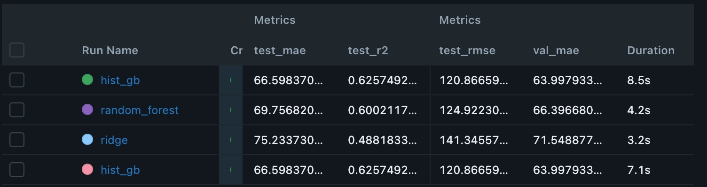
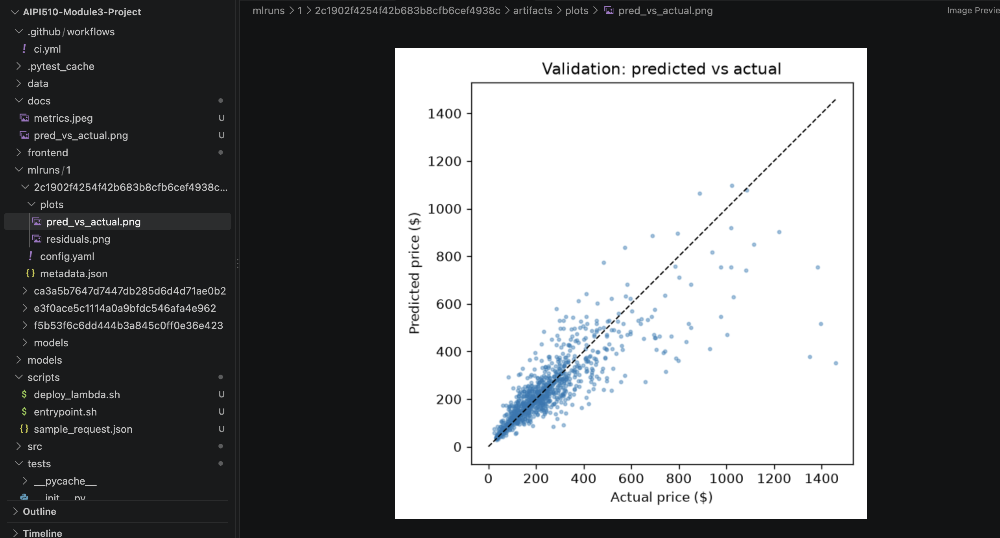

# DC Airbnb Nightly Price Estimator

An end-to-end ML project that predicts the nightly price of an Airbnb listing in Washington, DC. The pipeline pulls cleaned data from S3, trains a gradient-boosted model with every run tracked in MLflow, serves it through FastAPI on AWS Lambda + API Gateway, and uses a Streamlit front end hosted on Streamlit Community Cloud.

- **Live app:** _https://aipi510-module3-project-aeagdmogr6vxmi8mwaxzcz.streamlit.app/
- **API:** https://qvi9d9iugl.execute-api.us-east-1.amazonaws.com (`GET /health`, `GET /metadata`, `POST /predict`)

## Goals

The focus is the MLOps workflow, not leaderboard accuracy:

- Source, clean and host real-world data in the cloud (S3)
- Reproducible, config-driven pipeline (`config.yaml`) that runs in Docker
- Experiment tracking with MLflow
- Model served as a public API endpoint
- A front end that calls the live API

## Architecture

```
Inside Airbnb ──download──▶ data/raw ──clean──▶ data/processed ──upload──▶ S3
                                                                       │
                                     ┌─────────── ingest ◀─────────────┘
                                     ▼
                       train.py (sklearn Pipeline) ──▶ MLflow (params, metrics, plots, model)
                                     │
                                     ▼
                     models/model.joblib + metadata.json
                                     │  baked into Dockerfile.lambda
                                     ▼
          Streamlit Cloud ──HTTPS──▶ API Gateway (HTTP API) ──▶ Lambda (FastAPI + Mangum)
```

## Dataset

[Inside Airbnb](https://insideairbnb.com/get-the-data/): the detailed `listings.csv.gz` for Washington, D.C., scraped 2026-09-19. Inside Airbnb publishes the data under a Creative Commons Attribution 4.0 license.

- **Target:** `price` (nightly, USD). The model trains on `log1p(price)` because prices are heavily right-skewed.
- **Features (12):** neighbourhood, room type, guests, bedrooms, beds, bathrooms, shared bath, minimum nights, number of reviews, average rating, superhost, instant book.
- **Cleaning** (`src/data/clean.py`):
  - parse `"$1,234.00"` price strings
  - parse `bathrooms_text` (`"1.5 shared baths"`, `"Half-bath"`) into a count and a shared flag
  - convert `t`/`f` columns to booleans
  - drop rows with no price, prices outside $20–$1,500, and minimum stays over a year
  - deduplicate listings
  - merge neighbourhoods with fewer than 10 listings into "Other"
- Imputation and one-hot encoding happen inside the sklearn pipeline, so they're fit on the training split only.
- **Rows:** **6,906** raw → **5,901** after cleaning. Recent scrapes are missing price for many listings: 913 rows were dropped for having no price, 55 as price outliers and 37 as invalid.

## Model and evaluation

`src/features.py` builds a `ColumnTransformer` that:
- median-imputes and scales the numeric features, adding missing-value indicators
- passes the boolean features through
- one-hot encodes the categorical features

Its output feeds a `HistGradientBoostingRegressor`. Ridge and Random Forest are available for comparison runs through `model.type` in the config. The split is 70/15/15 train/val/test.

| Run | Val MAE | Test MAE | Test RMSE | Test R² |
|---|---|---|---|---|
| Median baseline | $125.61 | — | — | — |
| Ridge | $71.55 | $75.23 | $141.35 | 0.488 |
| Random forest | $66.40 | $69.76 | $124.92 | 0.600 |
| **HistGB (deployed)** | **$64.00** | **$66.60** | **$120.87** | **0.626** |

HistGB was selected on validation MAE; test metrics are reported once, for the selected model and the comparisons. Training is deterministic (fixed `random_state`): retraining inside the Docker image (Python 3.12) reproduced the local metrics (Python 3.14) exactly.

Test RMSE is nearly twice MAE because a small number of expensive listings carry large errors. Training on log price optimizes relative error, so high-end listings tend to be under-predicted.





The API also returns a "typical range": an empirical 80% interval built from the validation residuals in log space.

## Cloud services

| Purpose | Service |
|---|---|
| Data storage | AWS S3 |
| Container registry | AWS ECR |
| Model API | AWS Lambda (container image) + API Gateway HTTP API |
| Front end | Streamlit Community Cloud |
| Experiment tracking | MLflow (local SQLite store; screenshots above) |

## Setup and usage

### 0. Install

```bash
python -m venv .venv && source .venv/bin/activate
pip install -r requirements.txt
aws configure            # needs S3, ECR, Lambda, IAM, API Gateway permissions
```

In `config.yaml`, set `data.source_url` (copy the current D.C. link from Inside Airbnb) and `data.s3.bucket`.

### 1. Data → S3

```bash
aws s3 mb s3://<your-bucket> --region us-east-1
python -m src.data.download_raw        # Inside Airbnb -> data/raw/
python -m src.data.clean               # -> data/processed/listings_clean.csv
python -m src.data.storage upload      # -> s3://<bucket>/processed/listings_clean.csv
```

### 2. Train the model

```bash
python -m src.train                    # pulls from S3, logs to MLflow, writes models/
python -m src.train --model ridge      # comparison runs
mlflow ui --backend-store-uri sqlite:///mlflow.db   # http://127.0.0.1:5000
```

To work offline, use `--source local` to train from the local clean CSV. For a fake dataset with the same schema, run `python -m tests.fake_data`.

### 3. Build and test the API locally

```bash
uvicorn src.serve.app:app --reload
curl localhost:8000/health
curl -X POST localhost:8000/predict -H 'Content-Type: application/json' -d @scripts/sample_request.json
python -m pytest -q
```

Interactive docs are at http://localhost:8000/docs.

### 4. Docker

```bash
docker build -t airbnb-price .
docker run --rm airbnb-price test
docker run --rm -v "$PWD:/app" -v ~/.aws:/root/.aws:ro airbnb-price pipeline   # download→clean→S3→train
docker run --rm -p 8000:8000 -v "$PWD/models:/app/models" airbnb-price serve
```

### 5. Deploy the API to AWS

```bash
./scripts/deploy_lambda.sh     # ECR push + Lambda + API Gateway; prints the API URL
```

Run the script again after retraining. It updates the function in place.

### 6. Front end

```bash
pip install -r frontend/requirements.txt
API_URL=http://localhost:8000 streamlit run frontend/app.py
```

To deploy on [Streamlit Community Cloud](https://share.streamlit.io):
1. Choose New app, pick this repo, and set the main file to `frontend/app.py`.
2. Under Advanced settings → Secrets, add `API_URL = "https://qvi9d9iugl.execute-api.us-east-1.amazonaws.com"`.

## Project structure

```
config.yaml              all pipeline parameters
src/data/                download_raw.py · clean.py · storage.py (S3)
src/features.py          preprocessing + model factory
src/train.py             split · train · evaluate · MLflow · save
src/serve/app.py         FastAPI app + Lambda handler
frontend/app.py          Streamlit UI
scripts/                 entrypoint.sh · deploy_lambda.sh · sample_request.json
tests/                   cleaning + API tests (fake data, no AWS needed)
Dockerfile               full project (train / serve / test)
Dockerfile.lambda        serving image for Lambda
```

## Ethics and limitations

- **Asking price, not market value.** The target is the listed price on the scrape date, not what guests actually paid. Listings that rarely book are included alongside popular ones and we wouldn't know if the host lowered their price since there was less demand. 
- **One snapshot in time.** There's no seasonality: events, holidays and inauguration weeks swing DC prices a lot. 
- **Selection bias.** Rows without a price are dropped, and they may differ systematically from the rest (e.g. inactive or regulated listings). DC's short-term rental rules also shape which listings exist in the data at all.
- **Neighbourhood as a proxy.** Location is the strongest signal, and in DC neighborhood correlates with race and income. A tool like this, used to set prices or to choose where to buy investment properties, could reinforce gentrification pressure and reduce long-term housing supply. It also says nothing about why prices differ.
- **Host privacy.** The data is public and scraped, but it describes real hosts and homes. Only aggregate listing attributes are used, and no host names, IDs or free text are stored.
- **Not pricing advice.** The error is roughly ±$67 on average, and the interval is calibrated only on held-out data from the same snapshot.